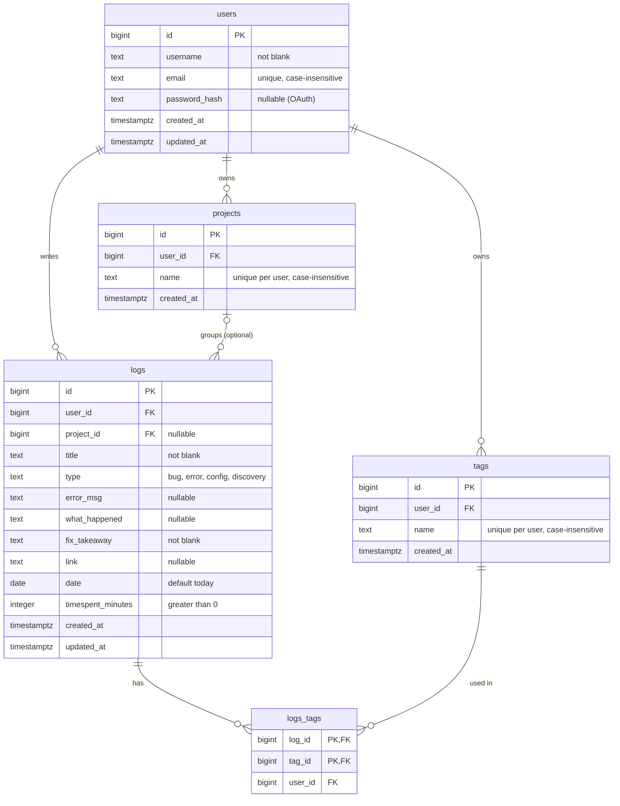

# Developer Logbook: Schema Design

PostgreSQL. Five tables: `users`, `projects`, `tags`, `logs`, and `logs_tags` (junction).

## 1. Diagram



## 2. Relationships

| Relationship      | Type          | Stored in              | On delete                |
| ----------------- | ------------- | ---------------------- | ------------------------ |
| users to logs     | 1:N           | `logs.user_id`         | CASCADE                  |
| users to projects | 1:N           | `projects.user_id`     | CASCADE                  |
| users to tags     | 1:N           | `tags.user_id`         | CASCADE                  |
| projects to logs  | 1:N, optional | `logs.project_id`      | SET NULL (log is kept)   |
| logs to tags      | M:N           | `logs_tags` (junction) | CASCADE from either side |

## 3. Constraints

1. Project name is unique per user, case-insensitive.
2. Tag name is unique per user, case-insensitive.
3. Email is unique, case-insensitive.
4. `timespent_minutes` must be greater than 0.
5. `type` must be one of `bug`, `error`, `config`, `discovery`.
6. Required text fields cannot be blank.
7. A log can only reference its own user's project and tags (composite foreign keys, see section 5).

## 4. SQL

```sql
create table users (
  id bigint generated always as identity primary key,
  username text not null check (btrim(username) <> ''),
  email text not null check (btrim(email) <> ''),
  password_hash text check (btrim(password_hash) <> ''),
  created_at timestamptz not null default now(),
  updated_at timestamptz not null default now()
);

create table projects (
  id bigint generated always as identity primary key,
  user_id bigint not null references users (id) on delete cascade,
  name text not null check (btrim(name) <> ''),
  created_at timestamptz not null default now(),
  unique (id, user_id)
);

create table tags (
  id bigint generated always as identity primary key,
  user_id bigint not null references users (id) on delete cascade,
  name text not null check (btrim(name) <> ''),
  created_at timestamptz not null default now(),
  unique (id, user_id)
);

create table logs (
  id bigint generated always as identity primary key,
  user_id bigint not null references users (id) on delete cascade,
  project_id bigint,
  title text not null check (btrim(title) <> ''),
  type text not null check (type in ('bug', 'error', 'config', 'discovery')),
  error_msg text,
  what_happened text,
  fix_takeaway text not null check (btrim(fix_takeaway) <> ''),
  link text check (btrim(link) <> ''),
  date date not null default current_date,
  timespent_minutes integer not null check (timespent_minutes > 0),
  created_at timestamptz not null default now(),
  updated_at timestamptz not null default now(),
  unique (id, user_id),
  foreign key (project_id, user_id)
    references projects (id, user_id) on delete set null (project_id)
);

create table logs_tags (
  log_id bigint not null,
  tag_id bigint not null,
  user_id bigint not null,
  primary key (log_id, tag_id),
  foreign key (log_id, user_id) references logs (id, user_id) on delete cascade,
  foreign key (tag_id, user_id) references tags (id, user_id) on delete cascade
);

create unique index users_email_lower_uq on users (lower(email));
create unique index projects_user_name_uq on projects (user_id, lower(name));
create unique index tags_user_name_uq on tags (user_id, lower(name));
```

## 5. Design notes

- **Why `unique (id, user_id)` on parents:** `id` is already unique, but a composite foreign key needs a matching composite unique key. This is what stops a log from pointing at another user's project or tag.
- **`on delete set null (project_id)`:** nulls only `project_id`, never `user_id` (needs PostgreSQL 15+).
- **Find-or-create** targets the expression index: `on conflict (user_id, lower(name))`.
- **`updated_at`** does not update itself. Set it in the ORM or app on every update.
- **Create order:** users, projects, tags, logs, logs_tags.
